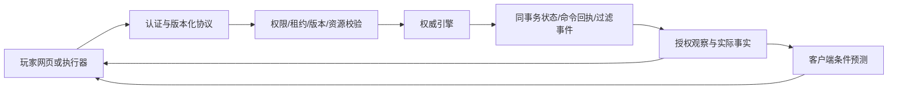

# 项目架构

## 包边界

| 包 | 责任 |
| --- | --- |
| `rules` | 固定参考参数、当前玩法规则配置 |
| `contracts` | 公共 DTO、输入验证、单位转换及协议 wire 类型 |
| `engine` | 真实世界、合法操作、推进、战斗、经济、可见性和终局 |
| `prediction` | 从授权玩家观察重建条件分支并预测，不读取服务器隐藏世界 |
| `server` | 权威实例、身份、控制租约、持久命令账本、事件、聊天、大厅与存档 |
| `client` | 玩家/实验室共用界面、大厅、控制台与浏览器本地预测 |
| `ai` | 控制器基础、模式组装和独立策略实现 |
| `player-sdk` | 传输、协商、快照、事件游标、租约和 outbox；不依赖策略或引擎 |
| `tools` | 可重放场景与本地命令行工具 |

公共包入口和依赖规则由 `scripts/check-boundaries.mjs` 检查。提取的原始规则函数有独立来源和校验；不要直接手改生成代码。

## 权威数据流

客户端预测与实际结算分开。命令接受、效果提交、舰队出发、抵达、战斗及战略成功是不同事实；未知不补零，也不凭实体消失推定结算。

## 控制器结构

`packages/ai/src/application/` 负责配置、模型传输、控制台和实例组装；`controller/` 提供观察、调度、分析、本地战术、执行、存储和诊断；`plugins/hybrid/src/` 是官方默认策略实现，组合后台模型和前台本地规划。策略定义通过每席位工厂实例化，自定义构建可从公共源码入口注册其他策略。

控制台通过独立服务接口访问运行器，检查点协调、席位资源和模型准入分别组装。核心通过注入的模式接口调用策略，不导入具体模式；模式不能互相依赖。需要复用的能力放进控制器基础或公共库，游戏写入始终走统一执行器。详见[模式接口](controller-bot-modes.md)。

## 入口与存储

实验室及直连玩家服务使用当前活动对局；多房间大厅在独立目录管理每房间状态。独立游戏服务可不加载网页、SDK 或 AI。运行器私有数据库与游戏 authority 分开；本机便利绑定只读取交接清单和玩家凭据，再通过玩家 API 核对身份。

正常游戏状态、私有笔记、运输账本、公开 wire 契约与研究资料分别维护。具体文件和一致性边界见[持久化](persistence.md)。
