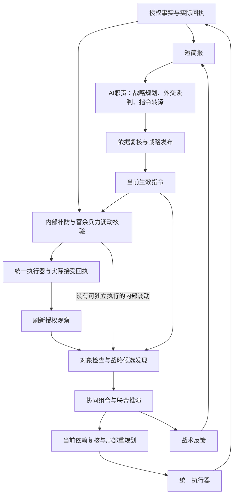

# 分层协同 bot

## 使用

控制台只提供分层协同。暂停席位后，选择“不配置模型 · 自主决策”，或配置 Codex / 兼容 API 模型，保存后启动。配置文件的 `settings.mode` 省略时默认 `hybrid`，显式设置也只接受 `hybrid`；供应商通过 `provider` 和连接配置指定。`offline` 表示不配置模型。旧模式名称及 `programmatic` 供应商拒绝使用。

本模式使用授权玩家观察、公开情报、聊天、通知、实际活动和执行回执，不取得管理员全图或隐藏数据。策略实现位于 `plugins/hybrid/src/`，确定性候选与条件推演位于 `controller/analysis/tactical-*.ts`。

模型连接可选择“不配置模型 · 自主决策”。此时后台不创建模型任务；没有已发布约束或待恢复操作时，前台使用 `controller/local/` 的本地搜索、计划连续性、侦察回执记录和资源校验。已有战略约束、持续任务与未完成操作仍走分层协同的恢复及执行守卫，不因关闭模型失效。新的自然语言指挥官要求无法在无模型时解析，前台报告原因并就绪，不阻止世界推进。

## 两条运行循环

后台 AI 专注长期胜利路径、外交交易和止损取舍，前台程序按已发布意图生成和比较行动。AI 决定重点争夺或暂不进攻的据点、关键兵力配置；来源选择、内部补防、富余兵力调动、航程、资源和战斗推演继续由程序完成。后台模型任务没有游戏写入权限；外交回复进入持久化消息队列，由控制器独立通信流程通过共用工具校验与玩家接口发送、核对回执，战术前台只负责行动规划。

后台发布结果时比较有效任务、执行约束和指挥官转译状态；仅摘要、理由、数组排序、审计版本或待发送消息变化不额外唤醒战术前台，结果仍正常保存。实际任务增改取消、禁攻或留守变化仍触发前台处理。同一活跃任务仅延长期限或改写理由时保留执行版本、任务状态及已有操作关联，不额外唤醒战术搜索，也不重复一次性运输。缩短期限、改变兵力等执行参数、来源关联或指挥官版本仍使旧待提交方案失效。实际提交继续检查最新期限、任务取消、完成、禁攻、留守和人工保护。

夺取任务可通过 `maxDrillersPerPlan` 限制单个完整方案向该目标新增派兵的总量，多来源联合出兵合计核验。搜索与实际提交使用同一限制；0禁止新增派兵，null不限，新任务省略不限，更新同目标省略沿用。该限制不等同跨轮累计投入或在途总量。兵力限制必须填写结构化字段，理由和摘要不执行；尚不能自动执行的累计止损条件写入复查条件，由后台根据实际事实取消或调整任务。

通信流程独立读取授权局势和会话并调度，不占用战术轮次或同一 tick 的战术运行名额，不设置战术复查提醒。读取、模型及回执等待不阻塞战术前台，操作上下文分别保存；实际写入仍由服务端串行校验和结算；已有待发消息不会使战术前台返回 `say` 或提前结束。发送前仍检查最新指挥官要求、会话材料、收件人、冷却和文本规则；聊天实际发送不签署合同或启用履约任务；正式协议使用独立的服务器命令与回执。通信请求先持久化稳定身份，结果未知时只查询原请求，不更换身份重发；未知通信回执不加入战术未决写入账本。消息本身不要求军事搜索，只有发送结果实际改变有效目标或约束时才唤醒战术前台。

候选条件推演使用进程共享、有容量限制的缓存，只在同一席位的当前前台轮次内复用，进入下一轮即失效；轮次指控制器决策轮，不是世界 tick。只有完整授权观察（含房间、席位、版本和小数时间）及完整推演参数完全一致才直接复用，时间、兵力、预测终点或敌方假设变化都会失效。失败和取消结果不缓存，缓存不跨进程恢复。

内部调动得到完整接受回执并刷新观察后，依据新局面正常进行战略搜索，不保留跨轮候选历史或增加历史方案复核分支。同轮命令因版本冲突被确定拒绝时，仍沿用本轮方案进行已有的定向复核；实际执行前权限、版本、资源、人工保护及最新意图检查继续生效。审计记录 `foreground-update` 是否改变执行输入，以及决策 `policyDiagnostics.forecastReuse` 的缓存命中和计算队列计时。



每席位后台任务串行执行，与该席位的指挥官讨论共用一个模型调用槽位；不同 bot 可以并行，共用进程模型队列，超过容量的任务在各自队列等待。并发容量、显式配置、队列轮转及供应商时限见[运行说明](ai-runtime.md)。后台排队不消耗模型的单次推理时限，暂停仍取消排队和在途工作；发出前核对任务及确认指令版本，已过时的请求不会发送。后台排队、推理和重试不阻止世界推进；首次开局没有战略时立即沿通用目标和当前有效约束规划，条件不足可保持现状。前台完成当前事实、实际回执和触发处理后独立报告就绪，不等待后台结果；后台发布有效战略或外交结果后登记下一轮原因；当前 tick 已完成时仅刷新后台外交，不重新观察和上报前台就绪。

后台任务区分排队与实际调用，审计记录包含派发、跳过、返回用量和失败。失败在调用列表与详情展示具体原因，并分别记录排队、供应商或回复校验阶段、供应商错误码、已报告的 HTTP 状态及重试间隔，保留排队耗时、供应商耗时、超时来源及有界传输诊断，不保存原始 HTTP 错误正文、stderr 或请求凭据。模型调用正文按[调用保留窗口](persistence.md#控制器私库)保存，窗口外仅保留摘要、指纹、用量、完成状态、归一化与校验审计；缺失完成证据不推测成功。认证、额度等不可恢复供应商错误不自动反复调用；可恢复供应商故障在同一任务版本内最多重试两次。顶层席位继续执行前台战术不代表后台成功，应查看 AI 任务记录及诊断事件。

战略定期巡检同时要求距上次评审至少 10 世界日和 5 分钟现实时间。普通局势变化合并后，至少间隔 12 世界日和 2 分钟现实时间再评审；变化未达派发条件时保留到后续观察，恢复原状则无需补调。矿量按胜利目标的 20% 阶段观察，不按固定 20 点反复唤醒；程序在等待与行动之间切换、普通舰队行军不触发全局规划。来袭按目的地、敌方、兵力的二倍量级、防守缺口与临近抵达阶段合并，至少间隔 2 世界日和 20 秒现实时间再评审，不因单支舰队身份或同量级小波次变化反复替换在途规划。己方据点归属或设施、新指挥官版本、已签合同状态变化，以及 12 世界日内出现实际来袭静态缺口仍可立即触发。无关联在途操作的模型任务持续等待 24 世界日或进入阻塞时，按任务执行参数和阻塞状态登记定向复查，沿用短复查间隔；仅延长期限不重复登记相同问题。外交来信由外交职责及时处理。触发审计区分初审、关键变化、来袭变化、意图阻塞、合并变化与定期巡检。相关事件合并为整轮材料，同一 bot 的不同职责依次执行，不同 bot 之间允许并行。每次战略评审只安排一份全局规划，常驻关键资产、经济与胜利进度、已有任务及实际执行反馈，核心据点与舰队事实默认提供，其他资料按整轮关联组织，不预先为每个地图区域调用模型。同一批次的触发依据保持稳定，不因首版战略发布或观察刷新重复初审；失败任务由可取消定时器按有界退避唤醒。

暂停取消后台工作并等待收尾；重启默认暂停，恢复已发布战略与持续任务，模型未完成结果不作为有效指导。检查点需要等待取消后的后台工作收尾。

## 简报与战略

外交模型输出的补贴使用一个可选 `subsidy` 对象，付款方与金额共同提供；省略或显式 null 表示无补贴。Codex 的严格生成投影通过存在性包装区分省略与显式 null，还原后继续按原语义校验。外交整数校验错误包含字段路径和允许范围，不保存原始响应或任意字段值。

夹击统一为双方各自在签署后的 200 tick 内占领共同敌人任意一个据点，不计算战损额度。保持主动接触、提案与接受机会，不增加谈判频率门槛。签约评估复用授权初筛检查目标、投入、集结与抵达期限；未评估或条件不足不等于禁止谈判，也不保证可履约。盟友行动保持未知。接受方同样承担主动进攻义务，程序提高未完成占领目标的优先级，不等待盟友先动；个人达标后退出新增履约目标，来源安全及指挥官约束保留。

战略摘要与目标理由表达取舍、目的和复查条件；当前兵数、矿数、设施现状和实际结算由程序事实提供。评估保存原始情报基准；观察版本、结构、来袭、新消息或排队评审变化不单独使已返回结果失效。回复按当前事实和权限尝试原子发布，真实冲突或非法内容整份丢弃，不拆分拼接或自动请求模型修复。已有战略判断保留到后续评审替换，不因结构变化清空。摘要单独保留其原始依据，不因其他分区或外交更新而刷新成新的事实日期。已占领目标、已完成或正在建设的矿场按授权状态退出相应执行目标，实际结算仍保留在审计中。


每份简报常驻己方矿场、当前授权可见的敌方来袭、己方据点库存与已接受预约扣除结果，以及公开胜利进度。开矿费用明确以建矿据点的兵力支付，矿量不作为支付资源；支付短缺与实际运输、防守可行性分开表达。全部简报常驻当前可见据点的名称、归属、类型、兵力和护盾，以及逐支授权舰队的归属、兵力、状态与目的地；模型正文不带可见性字段，程序仍先过滤当前视野；未知字段保留 null；局势、候选、任务目标、协议地点均使用完整名称，不附内部 ID。程序在输入输出边界双向解析，未知或重名拒绝，不模糊匹配。外交原文中准确提到的据点自动加入相关授权情报范围，避免遗漏相关地点事实；原始聊天和审计不改写。相关范围提供局部事实、粗分区、变化、约束、聊天原文及未知；通用进攻初筛和候选计算由程序保留，不常驻发送给模型；只有本轮明确相关的目标才发送程序结论与关键原因，不携带评分、配兵来源和路线细节。前台自主选取战术，与模型并行运行；模型依据执行问题调整战略和约束，不逐项审批进攻候选。明确区分授权事实、程序估算和候选建议，不把战术验证完成作为 AI 发布夺取意图的前提。用表格列名和行表达重复事实，不复制原始结算对象或全部审计材料。输入不超过 60,000 UTF-16 字符；超过时按实体或消息拆分，单条必要材料仍超限则记录阻塞，不静默截断。超限材料的各次拆分构造之间交还事件循环，避免阻塞网络响应和控制权续租；暂停取消尚未运行的拆分。较长指挥官正文按明确分段解释，全部完成后才发布完整约束。

模型只输出当前职责开放的语义结果，不需要游戏工具调用，也不提供 `needsInformation` 追加资料请求。资料不足时依据当前授权事实判断，必要时登记后续复查条件；返回已移除字段会被严格校验拒绝，不触发补充调用。供应商失败或无效结果不替换有效战略。模型可以发布有条件目标，战术推演证明不作为战略发布的先决事实。

调用分为三个职责，共用同一席位状态与执行器，不创建三套相互独立的认知：

| 职责 | 触发与输入 | 输出 |
| --- | --- | --- |
| 战略规划 | 开局、重要变化或巡检；全局摘要、已有任务与执行反馈、必要的相关目标结论 | 战略判断、少量意图增改取消、复查条件 |
| 外交谈判 | 新消息、主动联络或战术困境；当前会话笔记、未处理原文、最近双方发言、局势与相关协议 | 对外发言、内部真实意图、协议及真实履约所需任务 |
| 指令转译 | 玩家确认指令版本变化；完整确认正文、相关目标程序结论与当前任务 | 指挥官意图与硬约束，分段全部完成后发布 |

提示词按职责加载；战略与指令转译不携带完整外交谈判话术。 输出要求明确为符合当前 Schema 的单个合法 JSON 对象；使用最小空骨架展示浅层任务数组和顶层字段，不预填行动。模型任务项直接写 kind、target、until 等参数，取消用顶层 cancel；外交动作、共同敌人、补贴和内部谈判摘要直接写顶层字段。程序由 `model-wire.ts` 转换为内部任务编辑、正式外交动作与约束，并继续进行名称、权限和语义校验；保留归一化、权限和语义校验审计。外交沿用进攻初筛和当前会话关联目标，不因全局指挥官目标额外展开无关区域；战术困境只传因果摘要和搜索覆盖，完整搜索轨迹保留审计。数值建议使用有限精度，实际调兵与战斗仍按原始数据验证。指挥官私聊讨论仍使用独立讨论/确认流程，不属于自动外交。每个 bot 同时最多一个模型调用，指令转译优先，外交与战略按入队顺序处理；新来信或任务更新不插队挤占已等待的战略复查，不增加调用槽位。同一批未处理来信只随消息内容或指挥官版本更新而替换分析任务；普通战术困境列表变化不触发重复分析，新消息留待后续轮次，发布只确认本次实际展开的消息；结果按当前权限和具体冲突校验。

AI 只编辑战略判断与 tasks，不重建程序派生目标或任务状态；未提及的意图继续有效。已结束任务只提供最近结果摘要，执行约束作为只读输入。当前任务表保留完整执行目标与受阻反馈，不反复复制历史理由；任务原始理由仍保留在程序笔记和审计，不提供模型回读入口。外交轮的可编辑任务身份限定为当前会话已签合同的模型任务，其他战略和指挥官任务只读。输入权限清单及发布校验共用合同范围：进攻只选该合同仍有本方缺额的已知敌占目标，本方达标后不再生成履约进攻，合法防守支持与取消旧履约任务仍保留。唯一合同由程序绑定来源，多份合同需要精确选择；不同来源的同目标任务不能互相覆盖。主动联络根据授权聊天中的实际回复与已联络时间轮换对象，不读取对方控制器模式，也不将曾回复当作愿意合作。外交原文保留全部未处理消息与最近双方发言，较早已处理内容由会话笔记和结构化协议承接，完整原文仍保留审计；过期、终止及长期未确认的提案不再进入有效协议上下文。仅重复引用及完全相同的消息记录可无损去重；不同消息 ID 或变化的原文均保留。外交完整请求在模型派发前检查预算，仍超限时阻塞任务并保留未处理状态，不调用分块摘要或再拆分合并结果。

指令转译可以通过显式 upsert 已有模型任务 ID，将其纳入当前已确认指挥官要求。程序同时更新任务归属和指挥官版本；参数相同时保留任务版本、执行状态和原有操作关联，避免重复运输。参数改变时按正常任务更新处理。普通战略与外交仍不能修改指挥官任务。

模型结果先经过统一的输入归一化，再执行完整业务校验。空容器、说明文字及新增任务 ID 可省略；配置任务可省略未调整的一侧和一次性配置标记。模型浅层 Schema 和提示词要求夺取、配置及指定运输任务无论新增或更新都显式填写 0–100 的数值优先级，不能为 null；新增普通优先级为 50，保持原值时复制当前任务值。内部归一化仍对省略值提供有界处理：新增任务使用 50；更新任务只有在 ID、类型、目标、版本和修改权限仍匹配时才沿用原优先级，指定运输的来源也必须一致，不能为改目标或改类型的更新猜测优先级。目标、来源、期限和指定运输数量不猜测；指挥官转译仍须显式返回顶层 forbiddenPlayers、protectedSources、reserves 三个数组，不把缺失约束当作空约束。内部默认值由 `intent-schema.ts` 维护；模型浅层 Schema 由 `model-wire.ts` 按职责与协议能力固定生成，当前身份、期限与可编辑合同由动态权限清单限定，验证使用归一化后的内部结构。

返回值支持完整 JSON 代码块及一层 JSON 字符串包装；任务中明确的数字、布尔字符串可转换为相应类型，多余任务字段按当前 Schema 忽略且不执行。任务编辑外层重复的纯文字 reason 仅作为多余说明移除并审计，不替换 task.reason；已知但不适用于当前 action 的外交参数移除并审计，不执行补贴、不改条款；未知外层字段和冲突执行参数继续拒绝。fulfillAgreementId 可在顶层或浅层任务项中填写，程序仅归并完全相同的明确合同身份，冲突身份拒绝。未知名称、冲突值、指挥官限制、权限、资源、外交确认与发布前状态检查仍按业务规则处理。调用审计保留原始结果及逐字段归一化记录，字段错误包含具体路径与期望值。

供应商失败诊断只保留白名单阶段、原因码、HTTP 状态、响应字节数、正文字符数、结束原因和截断标识等结构化证据，不保存密钥、授权头或外部原始错误正文。外层 JSON 错误、缺失正文、语义 JSON 错误、语义非对象和超限分别报告；供应商声明 Token 截断的结果拒绝使用，即使正文看似完整。后台只对可恢复的供应商超时与服务故障重试。模型返回的格式、字段、权限或语义错误整份丢弃，不发布消息或任务，不追加纠错提示词，也不自动重试；失败原因、用量、结构化完成证据与校验摘要仍保留在审计中。

模型准确响应结构以 `model-wire.ts` 按职责与服务器合同能力生成的固定浅层 Schema 为准；本轮可用动作、引用和数量上限由 `facts.permissions` 给出，归一化后及发布前分别按捕获和最新权限校验；内部结构与动态授权契约由 `intent-schema.ts` 的共享构造器定义，内部状态与语义类型在 `contracts.ts`。兼容 API 的 `json_schema` 模式通过结构参数传递 schema；`json_object` 和纯文本模式将同一份完整 schema 追加在当轮 prompt 末尾，不能只要求返回 JSON 而省略字段结构，也不附加旧轮次材料。

当前任务共六类：`avoid` 禁止向指定据点新增派兵，`capture` 夺取，`configure` 己方兵力配置，`transfer` 指定友方运输，`return-fleet` 舰队返航，以及仅指挥官转译可创建的 `focus` 主攻安排。所有任务带绝对世界日截止时间；夺取、配置和运输带优先级。配置使用兵力上下界（null 不调整该侧），默认一次性；达到当前授权观察中的目标后关闭，不因后续库存变化重新派兵。显式持续配置会继续复查、尝试维持并提供最低留守约束，不保证库存始终不变。意图通过新增、按任务 ID 更新或取消编辑（除允许沿用的优先级外须完整填写）；未提及的任务继续有效，相同一次性目标不重复新建。新意图不能修改已确认指挥官任务。任务状态与受阻原因由程序维护；命令接受、在途和实际达到目标分开记录，不能凭舰队消失完成任务。

指定运输使用 `transfer`，结构化保留来源、友方目的地、兵量、优先级与期限。兵量为正整数时，安全可调库存不足则受阻；为 null 时，使用执行时该来源现有安全可调兵力。程序不改来源、接收点或将固定数量自动缩小，不用两个库存配置任务代替运输。运输仍通过完整友方交付路径、资源、来源风险与生存核验；提交后不重复补发，只有匹配订单的实际抵达交付结算才完成。同一指挥官版本的已交付运输保留完成证据，重新整理措辞不重复下令。返航、失败或未知结果保留为受阻；配置任务中的减兵运输也不能仅以离港后库存下降判定完成。

指挥官转译不能同时要求从某来源执行 `transfer`，又在 `protectedSources` 禁止该来源所有新出兵；程序在单份回复和多部分合并发布时均拒绝这种矛盾，不部分应用。维持其他自主安排不自动产生新的来源保护或最低留兵约束。

指挥官的 `focus` 指定主攻目标和集结/出发点。关联运输或一次性配置未完成、或持续配置尚未达标时，集结点不新增进攻；完成后，集结点仅向指定目标出兵。运输来源和集结点不作无关调出。正文明确“只能/只准/仅允许”或禁止其他进攻、严格单线时，全局限制为指定来源和目标；“优先/避免两线分散”保留其他安全来源的机会行动：最多一支在途或新增进攻、合计不超过当前总兵力20%，且不动用来源守备余量之外的兵力。机会行动仍须资源、占领、持有、矿场路径及反击检查，不因额度内就自动执行。禁攻、留守与人工保护仍是硬限制。接收点失守或真实来袭形成抵达缺口时允许安全复查；不保证撤离一定有利。

指挥官运输与配置操作绑定的在途舰队跨轮保留承诺，普通软收益不能撤回或改向，规划与实际提交各自复核。指挥官取消/更新、明确返航任务、到期或上述安全退出可解除对应限制；取消本身不自动返航。对可识别的跨点调出配置说明和“单线”等指令表达，发布前检查其是否分别落实为运输与范围任务，缺失则拒绝发布并返回字段/能力诊断；这不是对任意自然语言的完备语义证明。当前执行安排复核不通过时，前台保持现状并就绪，后台重新整理已确认正文，世界继续推进。

`avoid` 统一禁止向指定据点新增派兵，不论目标归属，覆盖进攻、增援及向该点返航，不自动撤回在途舰队，也不禁止从该点向其他允许目标调出。舰队意图仅支持 `return-fleet`，使用稳定舰队代号，程序提供当前己方舰队及返航资格；操作经共用执行器、人工保护和回执账本执行。返航依据实际返航事件、当前 returned 状态或匹配成功回执确认指令生效；返航舰数减半向下取整，每舰一次，返回出发据点，敌占则正常攻击。接受返航与实际到达分别追踪。结果未知时先查账，不重复提交；失去舰队观察不作为完成证据。

禁止派兵和持续配置最低留守进入候选与提交约束；夺取进入程序战略目标评分，配置进入内部调动候选的同一资源、路径、交付与生存检查。接收点当前有敌舰来袭和静态防守缺口，不单独阻止新的指定增援候选；完整联合预测仍须确认来源安全、友方交付和所需归属路径，迟到或不能救援的方案不执行。来源、兵力或期限初筛未通过时，反馈具体不足项；已有运输出现安全问题仍允许复查，并保持原回执关联，不自动补派。取消、到期或更新停止后续意图规划，已接受并出发的舰队不自动撤回。长期战略记录关注当前胜利规则、持续收益、对手静态获胜时钟、最大可接受投入与可观察退出条件；受阻后可取消、降级或替换目标，并以外交退出打开局面。AI 判断不替代游戏权限、人工保护和指挥官已确认要求。

## 外交与指挥官

外交评审和对外发言分别决定。来信继续完整入账和处理，模型可更新内部认知、修复履约任务后省略 `message` 或返回 null；纯确认、维持现状和未变化的等待条件通常不再回复。主动压力复查按当前会话、相关对手、收入量级、胜利阶段、合同及压力实质变化去重；单支来袭舰队换身份、同兵力量级小波次和无关玩家领土变化不重开相同评审。部分压力消失由材料变化表达，不清除全部会话去重记录；整轮压力完全解除后，新出现的困境可重新评审。未处理来信和待签提案继续独立准入，不受主动压力去重阻挡。首次有具体条款的合作、需要回答的问题、新结果及改变立场仍可发言；没有待签提案不妨碍主动谈判。军事实体编辑关闭只限制任务编辑，不代表不能提出合法协议。对外只表达对方需要知道的条件、请求、立场和结果，控制字段与其他会话预算留在内部；有意的威慑或欺骗仍由模型选择并记录战略目的。

`diplomacy-context.ts` 从已授权的具名简报整理双方身份与据点、可用停战范围、未处理来信身份及当前会话合同。对方可见合同数只表示下界，完整占用和实际剩余名额显式为未知；这不影响当前双边合同进度是已知服务器事实。履约材料将一个据点的占领义务与实际进攻投入分开，列出任务状态、执行原因、当前静态突破需求、初筛条件下的新增兵力估算、所列来源航程与期限风险，并保留同一合同敌人的相关初筛目标。当前驻军加护盾的静态数值不包含航行期间生产；初筛估算也不等于已经完成联合战斗推演。来源与航程检查只覆盖本次列出的条件，不排除其他集结方案或未来变化，真实在途和结算继续由程序追踪。

`diplomacy-message.ts` 在后台发布前校验当前会话的正式提案对象、停战归属及可响应身份，阻止个人已达标后继续新增该合同履约进攻、把其他敌人的夺取任务关联本合同，以及部分明确的对外主体、容量、签署、内部术语和无意披露其他会话合同的错误。校验失败直接丢弃本次回复，不改写原始输出、发送未经校验的片段或再次调用模型纠错。文字检查只覆盖可识别的明确断言，不能证明任意自然语言都真实；模型明确记录的战略欺骗与普通事实陈述区分，主动战略披露须记录目的，不能绕过实际命令权限、指挥官要求和服务器结算。

开局简报提供[中立点分区与覆盖](tactical-planning.md#开局中立点分配)，明确当前归属与对手可能先占的假设。已选争抢、已发布目标或本模式持续操作涉及对手近点/争夺点时，可提前触发开局竞争外交评审，比较增兵、预备反夺、边界协商和第三方合作，不把每个对手近点都自动变成外交任务。该评审不需要先等目标被敌方占领；发布前重新检查它仍是相关中立争夺点。实际归属改变或离开开局阶段后，旧的开局竞争依据失效，按当前事实重新规划。

外交允许主动联系、协商、威慑和游戏内欺骗。正式协议只有服务器签署的据点停战（固定 100 tick）与攻击第三方（固定 200 tick），时限不可更改。模型可通过结构化 diplomacyAction 发起、接受、拒绝、撤回或反提，夹击只选择共同敌人，矿产补贴在实际签署时原子交付。命令先保存稳定身份，经共用执行器提交；未知结果按原请求查账，不改键重签。命令已处理、合同已签署与个人已达标分别判断，不能凭聊天“同意”设置权威状态。细则见[外交协议](diplomacy-agreements.md)。

服务器观察自动产生当前履约目标，不要求 AI 抄录。停战守约策略只避开另一签约方当前持有的协议据点，不误禁己方增援或第三方行动；模型可明确设置 betrayAgreements 放弃该策略，仍须遵守独立指挥官和人工约束。夹击从有效服务器合同、存活双方与共同敌人、本人未达标责任中派生进攻目标；对共同敌人就近展开至多四个授权可见据点，每个敌人至多两个；仅签约不降低目标防御估算，实际战斗、联合推演和己方安全保持原值，不代表盟友已出兵或目标已削弱。

未签署的聊天承诺和待接受提案不产生外交义务，不自动禁攻或启用军事任务；内部谈判摘要只填写 summary 与 internalIntent；响应 Schema 不提供旧式协议状态、禁攻或 jointAttack 字段。动态权限清单仅列当前会话可操作的待签提案，停战据点仅列双方当前持有者。额外军事履约任务只允许关联当前会话已生效的合同身份（fulfillAgreementId），多份合同必须明确选择；无可编辑生效合同时权限清单将 tasks 与 cancel 的上限设为零，固定 Schema 仍保留格式分支，接受提案只提交外交动作，签署后由程序恢复目标。任务 ID 只能更新本轮权限清单所列既有意图，各任务种类的必要参数及未来期限在 Schema 中明确。个人达标或合同结束后停止对应来源的后续任务，已出发行动继续追踪，不删除重叠的指挥官和其他独立约束。普通战略任务保留自身来源。

外交提示词共享 100/200 tick 常量，明确签署起算、期限不可改、各自一个占领目标、固定信任奖惩和即时补贴。停战发起或接受前提供撤军减半损兵、回收点与对方可见在途风险；本方撤回批次全部回执确认后才提交合同，未知只查原请求，部分失败不签约，已发生损失不退款。生效后发现冲突舰队安排返航；独立指挥官、人工保护与不可返航事实仍须遵守并报告。模型可决定背叛，真实签署的服务器后果继续存在。关系、竞争排名、合同和近期回执由程序提供。

正式协议意图复用席位现有命令列表，按入队顺序执行；不同会话可以先保存意图，不因另一条命令待回执拒收整份模型回复。相同动作复用既有记录，不重复提交。实际回执持久保存后立即更新对应命令及撤军批次状态，无须等待下一轮战术规划；仍未知的结果只查原请求，阻止后续远程协议操作。执行前按当前事实、指挥官要求与撤军评估复核，失效的队首意图直接结束并检查后续项，每轮最多发出一条命令或一个撤军批次。命令已接受不等于协议已签署，正式状态以服务器协议和结算回执为准。

战术困境也会触发外交评审，无须等待定期巡检。真实来袭造成静态到达缺口，或授权可见兵力形成明显局部压力时，程序附上威胁、支援、缺口、已选响应和搜索覆盖；已选局部响应且没有条件损失证据时先让该响应执行。静态压力和有限搜索均不能证明本方无法防守。已发布进攻目标连续三个不同世界日未找到比等待基线更好的已评估攻占方案时，触发攻坚外交；重复观察不累计，目标尚未进入实际检查或只有未知结果不计为失败，已有可取进攻候选、正在执行的目标及禁止攻击目标不计为受阻。

完成有限候选检查、连续三个不同世界日没有更优行动且没有本模式操作正在执行时，也可触发僵局外交。单纯等待、同日重复刷新或只有未知结果不构成该证据；有价值行动恢复后清除连续计数。

每次最多合并三个困境，依据公开身份和可见地理优先评估第三方合作，也可与对手协商；不能据此推断第三方愿意参战或有可调兵力。简报要求比较求援、牵制、两线夹击、情报及利益交换，而非默认停战。AI 可以决定暂不发言；外交评审不等于已发送、已达成协议或盟友已经行动，仍不提供完整多方战役执行保证。

主动困境评审合并同一会话当前至多三个相关困境，复用既有发言冷却及当前来信的回复豁免；已知不能主动发言时不为催问调用模型，正式发送仍经过完整预算、版本及权限检查。相同困境主动评审至少间隔 60 秒现实时间且六个世界日；成功评审后，材料不变不会仅因冷却结束而再次触发同会话。新的实际来袭组成或兵力、目标归属或设施变化、困境类别、到达缺口状态、临近危险窗口、公开胜利阶段和协议条款变化可重新打开评审；普通产兵、航行、候选评分、搜索次数和措辞变化不单独触发。协议或联合进攻期限进入六个世界日内时可重新评估。已解除困境再次出现时按新事实处理；有新来信时照常理解并处理，不受主动联系去重限制。评审记录随私有状态保存，重启不抹掉已完成评审。优先轮换尚未评审当前材料的候选；同会话的待发送或结果未知消息阻止新增主动评审。有来信时把相关困境并入现有会话，保留原文。连续受阻计数和评审记录保存在私有 `mode-hybrid-state.diplomacyPressure`，证据保存在 `mode-hybrid-feedback.diplomacyNeeds`，主动调度记录为 `mode-hybrid-diplomacy-trigger`。压力变化不单独拒收已返回的回复；当前权限、合同状态及具体操作冲突仍须通过校验。新指挥官版本尚未整理时暂缓新增主动评审。

外交提示词要求利益基本一致时直接接受，有实质分歧则一次反提、拒绝，也可假意接受或欺骗；只追问会实质影响交易的关键缺项。 对已确认同条款、普通致谢或重复表态，没有新增情报、必要要约回应、条款变更或履约修复时，模型应省略消息或返回空消息；是否答复由模型判断，程序不按关键词猜测来信意义。对外消息以玩家口吻直接表达表态和交换，通常一到三句，不附后台流程、免责声明或泛泛互助套话；没有具体收益可以不发言。真实目的、风险、退出条件和履约阶段留在内部记录，口头同意、愿意履行和已经交付分别表达。游戏内欺骗不能改变内部事实或指挥官硬约束。

可讨论边界、情报、共同牵制与分阶段反要约，但只有合法签署条款受服务器协议规则裁决。舰队赠予、兵力原子交换、托管、据点转让、担保和自动条件交易没有接口。新提案在没有聊天时也触发外交评审；签署、个人达标、违约及结束进入现有整轮上下文。程序不能按利益评分自动签约或解除合同。

外交发言、签约命令回执、服务器合同及内部真实意图分别保存和展示。合同当前目标由真实观察恢复，接受结果未知不假定未签署；签署失败按双方回执解释。来源任务受阻时记录具体原因并安排外交修复，不改写历史发送事实。前台提交前读取最新战略，不能以较早局部规划覆盖后台刚发布的指令。无模型模式维持已有义务和未决查账，不自动开展谈判。

指挥官讨论复用现有独立提案与玩家确认流程。已确认正文解释为本模式指导；新版本尚未整理完成时，前台继续观察、核对实际回执并续租，完成保持现状的轮次后报告就绪，世界可继续推进。此时跳过进攻预计算，不用旧指挥官版本提交自主行动；保留距最近搜索的复查基准，后台发布当前版本后登记待办，当前 tick 已开始前台轮次时留至下一 tick。整理失败先按 5 秒、30 秒重试，随后可恢复失败至少间隔 60 秒继续重试，不以世界日推进作为恢复前提；不可恢复的供应商错误仍需检查配置。指示提到的据点资料随整理简报提供。未经确认的讨论不成为生效命令。

## 控制台调用日志

日志页的“自动决策”列表统一展示每次后台模型请求（战略规划、外交谈判、指令转译），包含任务、尝试次数、模型与推理强度、完整提示词、响应 Schema、返回的结构化模型输出、UTC 排队/发送/结束时间，以及排队、模型和总耗时。同一请求的排队和结束记录合并为一条可选调用，按最新调用优先显示；重试及分段分别记录。选择调用后可切换上下文、回复和包含响应 Schema 的请求参数。日志页不展示执行记录模块。结束状态区分已发布、过时、失败和取消，模型返回不代表战略已发布或游戏操作已执行。

Token 明细按供应商报告展示输入、输出和缓存输入；缺失标为未报告，未取得完整输入/输出用量时不显示确定合计。取消或失败仍保留请求上下文；未取得可解析输出时明确标示，不伪造模型正文。此处模型输出为适配器返回的结构化回复，不含供应商未提供的内部推理。控制台导出经过已知凭据及凭据模式脱敏。历史日志未记录的上下文和输出无法补回。

实时运转主布局按运行状态、bot槽位、内容面板、底部指标四行分配；宽屏与低高度断点使用相同区域顺序，内容面板占用剩余高度，底部指标保持紧凑。竖屏将槽位分为两行、内容面板分为上下两层，整体仍适配窗口；较长的指令内容在模块内部滚动，页面不出现横向或纵向滚动条。

实时运转的两条独立流程融入对应模块：AI引擎内展示任务调度、模型排队、模型处理与指导发布，搜索网络内展示程序本轮同步、搜索推演、复核执行与回执记录，不额外占用顶部流程条。搜索推演涵盖候选发现、兵力细化、组合及压力测试；待命作为状态栏显示，一轮结束后回到监听状态，不作为额外处理节点。两条流程的节点名称使用相同的固定字号，不随各自 SVG 缩放。顶部席位选择卡使用紫色 AI 引擎与蓝色程序前台双圆环；后台处理与前台运行分别驱动旋转和脉冲，蓝圈覆盖事实同步、搜索推演、执行及就绪上报，具体阶段由文字状态说明；规划准备显示“本轮同步”，普通观察轮询显示“后台观察”，上报就绪显示“就绪上报”，后台观察不点亮本轮同步节点，待命、暂停或断线时停止，历史搜索记录不驱动动画。两侧依各自实时遥测独立点亮，可以同时运行；已发布指导和已有回执显示为静态记录，不以旧任务或历史回执驱动当前动画。两个模块通过已发布指导、授权事实与实际回执交换信息，不表示逐轮同步或程序必须等待本轮模型返回。

常规标题、方案、选中态与运转光效使用青蓝、绿、紫等颜色，待处理、受阻和提交未确认使用琥珀色；红色保留给明确失败、拒绝或违约。方案与执行保留一份指令列表，不另设重复的当前方案动作列表；顶部仅显示方案类型与指令数量。执行指令按最近五个实际决策轮分组，按每条指令自己的回执展示下达状态：确认下达后统一显示已下达，不以舰队抵达或战斗结果作为列表完成条件；待下达、明确未下达和提交未确认分别标示。同轮内部调动与战略批次合并展示；无可展示指令时明确标示，不用早期未决操作填充近期列表。搜索网络按席位绑定和决策轮隔离，累计同轮已报告节点；维持节点固定在中心，外围节点按共享目标形成有机节点簇，类别通过颜色区分；同一目标的来源和兵量变体优先相邻，空位避让维持可读间距。细线只表达共享目标、共享出兵来源或程序记录的组合成员关系，均为无方向关联，不代表搜索父子关系；不绘制从维持或类别标题发出的虚构依赖线。实际运行的候选关联显示光轨、脉冲与节点放电，结束后停止这些运行特效；星云、星尘和透视底网属于独立装饰背景，不表示搜索状态，并遵从减少动态效果设置。组合方案不占用额外圆点，通过底部组合选择同时高亮程序记录的真实组成候选；单独的舰队操作仍是动作节点。未单独评估的组成候选显示为组合组成，不继承组合评分或通过状态；缺少组成数据的记录不猜测高亮关系。选中候选摘要固定在底部；悬浮或键盘聚焦时展示具体候选动作、目标、兵力／开关参数、计划时间与生成理由，不依赖是否存在出兵路线。未报告动作的记录明确标示缺失，不按类别或 ID 猜测动作。类别图例位于画布右下角纵向排列，布局为图例留出空间。搜索模块以同一背景覆盖标题、程序流程、网络和底部统计；连接使用平滑三次曲线。位置表示方案关系，边框颜色表示类别、圆心颜色表示评估状态，蓝色光环表示当前查看项、绿色标记表示最终方案。新增节点与状态更新不重排已有节点，评分变化不移动节点。新节点在一秒内随机错峰淡入，状态更新不重复播放，减少动态效果设置下直接显示。协议与约束按每行五个放大图标排列，内容较多时在模块内滚动，悬浮或键盘聚焦以组件同风格的浮层显示类型、状态和具体条款；浮层避开窗口边界，不受模块滚动裁切，支持滚动阅读和 Escape 关闭。布局随容器宽高缩放，圆点保持圆形；点击、Enter 或空格可选中查看候选，使用圆点和光环高亮，不显示矩形焦点框，也不改变实际执行方案。结束后保留网络，合并最终评估状态并停止流动动画；最终方案发布后再高亮，尚未完成的分支不伪装成评估成功。

AI 指导的战略、外交和指挥圆圈显示当前绑定私有记录内对应类别的累计已记账调用数，读取持久化的后台用量计数，不统计当前任务行数。已返回或发出后失败的调用计入，在途调用记账后更新，排队未发送不计；尚未取得统计显示未知，已取得但该类别没有调用显示0。指挥统计对应已确认要求的后台转译，独立指挥官讨论保留其自身用量口径。

## 控制台笔记

笔记顶部并排展示最近行动与运行详情，窄屏时上下排列，下方展示战略判断与当前生效指令：

1. **战略判断**：AI 保存的长期取舍，不作为自动执行指令。
2. **当前生效指令**：合并有效意图、外交产生的限制与程序规划目标，显示来源、期限、状态和原因。相同任务及其派生目标不重复展示；同一据点同类型的既有规划目标合并显示最高优先级，显示合并不改写存储或战术评分。配置任务一并显示实际最低留守，包含已接受预约的资源承诺。服务器正式合同与签约操作回执单独展示，内部谈判记录不冒充签署。守约策略与指挥官等独立约束分别标明来源；当前目标只使用有效合同，近期终态与回执作为结果摘要提供，完整历史不塞入工作集。
3. **最近行动**：当前战术及未结束操作汇总，具体操作与回执折叠展示；每个批次子操作分别追踪准备、在途、成功、明确失败、取消和未知。非运输操作按实际接受回执收尾，运输以精确舰队身份及实际结算事件收尾；已结束操作与指令不在笔记界面显示，底层执行记录保留。命令接受、在途和实际完成分别记录，取消意图不撤回已出发舰队。

最近行动位于笔记顶部左侧；右侧运行详情直接显示战略/指挥官版本与条件模拟次数，并收纳可展开的程序约束明细、AI 任务记录及外交发送回执。任务记录保留各任务最近状态与最近八项结束记录，包含未发出调用的上下文阻塞；不能解释为调用总数、并行数或军事任务数。调用次数以模型用量及日志为准；任务状态保留在任务记录，不把持久化的上次处理中状态当作当前模型仍在运行的证明。

工作集保留全部未决操作与相关意图，另保留最近十二项已结束操作/意图及最近八项已结束外交发送记录。模型简报和指挥官讨论不提供状态已过期或期限已到的意图，也不提供其历史计数；近期结果仅包含未过期的已完成或已取消意图，最多六条。过期意图的底层记录及已接受操作的独立回执追踪保留。战术困境简报提供威胁、缺口、目标和搜索覆盖摘要，完整搜索轨迹留在审计中，避免重复塞入外交上下文。已处理聊天压缩为当前必要证据和最近双方发言，未读与未确认写入证据不删除；原始记录继续保留在私有审计日志中。历史活动补查按固定授权游标有界分页，修复漏过的结算后提交游标，避免每轮全量回读。

生效规则直接使用前台同一份当前授权观察与指导计算。没有当前观察时标明不可核实，不把缺失数据显示为零约束。显示使用据点名称和可读舰队代号，原始审计与执行身份保留。

## 战术、资源与版本

前台将己方内部兵力调动纳入同轮战略搜索，使用统一加权收益选择。补防缺口、安静后方富余兵力前送与程序 bot 共用 `controller/analysis/internal-transfers.ts`，使用[局部风险估算](tactical-planning.md#局部风险与兵力调动)。候选生成就扣除已发布的最低留守并排除保护来源；多个来源共用目标剩余缺口，不把假设交付当作当前可支付兵力。每次最多三项内部调动，可联合核验；假设交付后的整体风险变差，不进入内部短名单。

内部候选的初步核验使用约 24% 的本次规划模拟/时间额度，确认完整窗口内的友方交付、所需来源与目的地归属路径、生存和终局类别。通过初步核验后，与进攻、开矿等候选一起接受必要的有限敌方反应检验，并按[统一加权收益](tactical-planning.md#决策链)竞争；不提前绕过收益门槛执行。迷雾据点的未知抵达保留在全局覆盖说明中，但不单独否定另一座完全可见据点在该条件分支内的连续控制；未知航向和未覆盖窗口仍阻断核验。有限推演不构成全局安全保证。


战略目标贡献按同一条件场景下，相对 hold 增加的据点控制时间或矿场完成后的控制时间计算，按共同窗口归一化并以目标优先级限幅。同一目标重复派小舰但没有提早占领、延长持有或改善建设完成时间时不重复加分；重复目标只计一次。各压力场景分别使用自己的 hold 基线，未知资料不补成控制收益。

前台同时使用[进攻削弱与有限消耗评分](tactical-planning.md#经济与持矿评分)：公开排名靠前或接近胜利的对手获得较高削弱收益，弱威胁对手获得较低收益。服务器夹击通过未完成的占领目标提高进攻方向优先级，不因杀伤产生履约进度。普通削弱评分仍比较敌军损失与己方投入，但不代替真实占领，不证明盟友已经出兵；未夺取的据点不会标记为夺取任务完成。

内部批次和后续战略批次使用不同的持续任务身份。只有同一轮对应内部批次的全部操作明确接受、无未决写入，并刷新授权观察后，才继续本轮战略搜索；接受只证明命令已接受，不表示兵力已抵达。后续搜索跳过内部阶段，保留其真实命令关联，避免同轮撤销、改向刚接受的内部运输。部分成功、拒绝、结果未知、无法关联的回执或无法刷新时结束当前步骤，交给现有执行账本和下一轮事实复查，不重发内部批次；持久化阶段标记防止恢复后重复执行。战略和指挥官约束在后续步骤及实际提交前继续复核。

程序按据点、舰队及战役相关候选发现机会，轮转目标以减少长期遗漏；支持运输、多来源进攻、集结、开矿和联合方案。多战线分兵同时提供普通战斗下限和带余量的候选，各来源只分配一次；最终仍比较运输、存活守军与后续压力，保住更多据点不自动代表长期收益更高。相关候选共享整体资源校验，内部承诺、服务器预约和已出发舰队分别维护。

本地规划主搜索统一使用席位的 `maxElapsedMs`，默认 8 秒，不按普通或复杂场景分档；默认最多 80 次条件推演，任一预算先耗尽即停止。计算在工作线程内运行，共用有界预测池；截止时只返回完成的检查点，未完成分支取消。有战略目标时先分配30%发现预算，没有目标时保留程序化策略的60%初筛宽度，同时继续检查全部已发布约束。细化与多指令组合使用剩余预算，组合尝试最多为总预算25%、上限二十次；支持单项不足时的多来源联合进攻及不同目标的联合操作，具体见[本地战术规划](tactical-planning.md)。细化、组合未用完的推演额度可以回流到候选发现，为实际生成的有限敌方反应场景预留验证额度，并服从总时间截止；实际覆盖仍受合法性、可用场景与缓存影响。

先检查约束、生存和终局，再比较启发式收益与战略贡献。评分不是胜率，有限压力场景不代表穷尽反击。对象只有实际进入候选评估才标记 assessed，未覆盖对象明确标记待搜索。

进攻意愿与程序化模式共用[兵力占容量比例调整](tactical-planning.md#运行与参数)：越接近满兵，攻占收益门槛与进攻兵力机动机会成本越低；内部调动、守备缺口、战斗验证和已发布战略约束仍采用各自原有检查。

一轮战术默认可以跨多个 tick，广泛搜索与提交前复核分别计时。搜索使用固定的授权观察形成方案；返回后刷新观察，时点或版本已改变时，以独立的 5 秒、最多 32 次条件模拟预算复核所选方案。复核只把立即指令的执行日移到当前日，保留原兵量和目标，不重新发现候选、缩兵或组合；继续检查当前资源、人工保护、战略约束、路径、生存和终局，所有自主行动均与当前 hold 及必要的有限敌方反应场景按相同的60%普通、40%压力加权规则比较。内部调动另保留完整交付核验。

搜索原依据和当前复核依据分别留在私有审计中；实际提交绑定已复核的观察版本，不把观察器后来读到的新版本套给旧方案。提交及批次每条实际操作前再次检查战略约束，服务器继续执行当前权限、版本与资源校验。批次所有项均确定未生效且返回 REVISION_CONFLICT 时，最多刷新并复核原搜索方案一次，不重跑广泛搜索；已接受、未知或其他拒绝不进入此重试。复核失败、超时或已无更优方案时保留现有行动。观察器在距最近一次实际完成搜索达到席位的 `reviewIntervalTicks` 时登记战术复查，默认 6 tick，有无模型均采用此值；首次没有搜索记录时执行初次检查。搜索选择维持也计为完成搜索；发送消息、核对回执、等待约束、结束轮次和同轮复用旧结果均不重置计时。该基准按席位持久化，重启后继续使用；前台结束不再设置周期战术提醒。各类事件统一经过事件合并窗口后进入下一次允许的前台轮次，不再按紧急标记区别调度；首次启动、显式恢复与手动分析可直接运行。其他有效事件仍可提前触发搜索。

实时模式每 tick 为现实 10 秒，世界不等待战术，tick 边界不会自动中断或并发启动本席位的另一轮。搜索预算耗尽不占用后续复核预算，也不因单纯跨日丢弃搜索工作。搜索、复核、网络和回执合计可以超过一个 tick，仍受整轮运行时限、暂停和取消保护；不保证每 tick 响应或每轮必定执行。若局势持续快于复核与提交变化，有限版本冲突重试后仍可能延后行动。

持续任务只依据真实回执关联命令与舰队；列表消失不代表抵达。bot 不登记或取消预约，玩家预约继续参与资源核算。已接受计划和在途行动不会因为战略文字改变自动获得撤销效果。

## 观察与验证

控制台当前笔记页展示战略版本、指挥官整理版本、后台任务、外交与内部意图、消息回执、持续任务及后台用量。模型用量、战术计算和游戏执行分别记录；缺失用量不估算。

离线性能工具：

```powershell
npm run build
node scripts/benchmark-hybrid.mjs --samples=20 --parallel=2 --output=runtime/outputs/hybrid-performance.json
```

保存的授权观察可用于只读影子回放：

```powershell
node scripts/hybrid-shadow.mjs path/to/observation.json runtime/outputs/hybrid-shadow.json
```

输入可为 PlayerObservation，或含 observed / observation 字段的报告；可额外传入同房间同玩家的战略 JSON。工具不调用模型、不发送指令、不推进对局，比较维持现状与所选方案的条件结果。

性能工具使用合成的 20 据点玩家授权观察，轮换种子和席位，不连接游戏或模型。它测量条件规划耗时，不测量真实外交能力或整局策略强度。具体测试记录保存在 runtime/outputs；只有固定条件下的完整对局比较才能支持强度结论。

## 关系策略参数

关系策略集中在 `plugins/hybrid/src/relation-policy.ts`，服务器生效名额见[外交协议](diplomacy-agreements.md)。合作对象仍优先处理已有回应，在同类对象中用距离减去有界关系加分排序：本方对其信任×0.2，加其对本方信任×0.1，结果限制在±12；联系时间用于平分排序。高信任参考线20、低信任参考线−20，不自动接受或禁止谈判。

AI 建议并行未完成承诺不超过两份、敌对方向不超过两个；只整理现有占领义务和名额，不按兵力折算新增额度，也不新增签约频率限制。补贴建议不超过库存10%且最多5矿，仍须比较对方收款后的获胜距离。以上战略建议可因明确收益调整；服务器每席停战2份、夹击2份的生效上限不可突破。

运行计时保存在本地诊断：AI 私库的 `runtime-poll-timing` 区分快照读取、决策轮与入场就绪撤回，`runtime-readiness-timing` 记录就绪请求及其重试总耗时；服务器 `tick-performance.jsonl` 记录推进检查的串行排队、检查执行、首个未就绪席位、世界结算和落盘耗时，文件按大小轮转。快照读取包含网络及服务端处理；轮询剩余时间包含事件整理、回执查账与持久化，不能进一步当作独立精确分项。各席位和后台并行，诊断时按墙钟区间去重，不累加为 tick 耗时。
